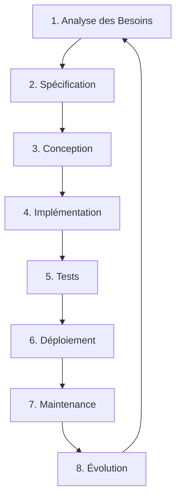

# Section 1 : Introduction au Développement Logiciel

## 🎯 Objectifs d'apprentissage

À la fin de cette section, vous serez capable de :
- Comprendre les enjeux du développement logiciel moderne
- Identifier les différentes phases du cycle de vie d'un logiciel
- Reconnaître les critères de qualité d'un logiciel
- Appliquer les principes de base des méthodologies de développement

---

## 1. Les Défis du Développement Logiciel

### 1.1 Pourquoi développer un logiciel est complexe ?

Développer un logiciel moderne nécessite la coordination de plusieurs ressources :

#### **Ressources Humaines**
- 👨‍💻 Développeurs (frontend, backend, fullstack)
- 🎨 Designers UI/UX
- 🧪 Testeurs QA
- 📊 Chefs de projet
- 📝 Rédacteurs techniques

#### **Ressources Matérielles**
- 💻 Ordinateurs de développement
- 🖥️ Serveurs de test et production
- 🗄️ Systèmes de stockage
- 🌐 Infrastructure réseau

#### **Ressources Technologiques**
- 🔧 Langages de programmation
- 📚 Frameworks et bibliothèques
- 🛠️ Outils de développement (IDE, Git, CI/CD)
- 🗃️ Bases de données

---

### 1.2 Les Problématiques Classiques

```
❌ Problèmes fréquents :

1. Communication difficile entre équipes
2. Cahier des charges incomplet ou ambigu
3. Modifications fréquentes des exigences
4. Code difficile à maintenir
5. Bugs découverts tardivement
6. Délais et budgets dépassés
```

**💡 Solution** : Mettre en place un **processus structuré** et une **méthodologie rigoureuse**.

---

## 2. Le Cycle de Vie d'un Logiciel

Le cycle de vie d'un logiciel décrit toutes les étapes de sa création, de sa conception à sa maintenance.

### 🔄 Les 8 Phases Principales



---

### Phase 1 : Analyse des Besoins 🔍

**Objectif** : Comprendre CE QUE le client veut.

**Activités** :
- Réunions avec les parties prenantes
- Identification des utilisateurs cibles
- Liste des fonctionnalités attendues
- Contraintes techniques et budgétaires

**Livrable** : Document de recueil des besoins

**Exemple** :
```
Besoin : "Je veux une application mobile pour gérer mes dépenses"

Questions à poser :
- Sur quelles plateformes ? (iOS, Android, les deux ?)
- Combien d'utilisateurs prévus ?
- Faut-il une synchronisation cloud ?
- Quel budget et quel délai ?
```

---

### Phase 2 : Spécification 📋

**Objectif** : Clarifier et détailler les besoins sans ambiguïté.

**Activités** :
- Éliminer les redondances
- Lever les ambiguïtés
- Définir les cas d'utilisation
- Créer des maquettes (wireframes)

**Livrable** : Cahier des charges fonctionnel détaillé

**Exemple de spécification** :
```
Fonctionnalité : Ajout d'une dépense

Scénario normal :
1. L'utilisateur clique sur "+ Nouvelle dépense"
2. Il saisit : montant, catégorie, date, description
3. Il valide
4. La dépense apparaît dans la liste
5. Le solde est mis à jour

Scénario alternatif :
- Si montant négatif → message d'erreur
- Si catégorie non sélectionnée → "Autre" par défaut
```

---

### Phase 3 : Conception (Design) 🎨

**Objectif** : Définir COMMENT le système sera construit.

**Activités** :
- Architecture logicielle (couches, composants)
- Modélisation UML (diagrammes de classes, séquences)
- Choix des technologies (langages, frameworks, BDD)
- Conception de la base de données

**Livrable** : Dossier de conception technique

**Exemple - Architecture 3 tiers** :
```
┌─────────────────────┐
│   Couche Présentation │ ← Interface utilisateur (Vue)
│   (UI/UX)            │
└──────────┬──────────┘
           │
┌──────────▼──────────┐
│   Couche Métier      │ ← Logique applicative (Contrôleur)
│   (Business Logic)   │
└──────────┬──────────┘
           │
┌──────────▼──────────┐
│   Couche Données     │ ← Accès base de données (Modèle)
│   (Data Access)      │
└─────────────────────┘
```

---

### Phase 4 : Implémentation (Codage) 💻

**Objectif** : Transformer la conception en code fonctionnel.

**Activités** :
- Écriture du code source
- Respect des conventions de codage
- Commentaires et documentation
- Versioning avec Git

**Bonnes pratiques** :
```java
// ✅ BON : Code clair et documenté
/**
 * Calcule le montant TTC à partir du montant HT
 * @param montantHT le montant hors taxes
 * @param tauxTVA le taux de TVA (ex: 0.20 pour 20%)
 * @return le montant TTC
 */
public double calculerTTC(double montantHT, double tauxTVA) {
    return montantHT * (1 + tauxTVA);
}

// ❌ MAUVAIS : Code obscur
public double calc(double m, double t) {
    return m * (1 + t);
}
```

---

### Phase 5 : Tests 🧪

**Objectif** : Vérifier que le logiciel fonctionne correctement.

**Types de tests** :

| Type | Objectif | Qui teste ? |
|------|----------|-------------|
| **Tests unitaires** | Tester chaque fonction isolément | Développeurs |
| **Tests d'intégration** | Tester l'interaction entre modules | Développeurs |
| **Tests fonctionnels** | Vérifier les fonctionnalités | Testeurs QA |
| **Tests de performance** | Évaluer la rapidité et la charge | Testeurs |
| **Tests d'acceptation** | Valider avec le client | Client final |

**Exemple de test unitaire** :
```java
@Test
public void testCalculerTTC() {
    // Arrange
    double montantHT = 100.0;
    double tauxTVA = 0.20;
    
    // Act
    double resultat = calculerTTC(montantHT, tauxTVA);
    
    // Assert
    assertEquals(120.0, resultat, 0.01);
}
```

---

### Phase 6 : Déploiement 🚀

**Objectif** : Mettre le logiciel en production.

**Activités** :
- Installation sur les serveurs
- Configuration des environnements
- Migration des données
- Formation des utilisateurs

**Stratégies de déploiement** :
```
1. Big Bang : Tout d'un coup (risqué)
2. Déploiement progressif : Par phases
3. Blue-Green : 2 environnements (ancien/nouveau)
4. Canary : Tests sur petit groupe d'utilisateurs
```

---

### Phase 7 : Maintenance 🔧

**Objectif** : Corriger les bugs et assurer le bon fonctionnement.

**Types de maintenance** :
- 🐛 **Corrective** : Corriger les bugs
- 🔄 **Adaptive** : Adapter aux nouvelles technologies
- ⚡ **Perfective** : Améliorer les performances
- 📈 **Évolutive** : Ajouter de nouvelles fonctionnalités

---

### Phase 8 : Évolution 📊

**Objectif** : Faire évoluer le logiciel selon les nouveaux besoins.

**Cycle continu** :
```
Nouveaux besoins → Analyse → Conception → Développement → Tests → Déploiement
```

---

## 3. Critères de Qualité Logicielle

### 🎯 Les 6 Piliers de la Qualité

#### 1. **Correction** ✅
Le logiciel produit les résultats attendus conformément aux spécifications.

```java
// Exemple : Fonction de calcul correcte
public int somme(int a, int b) {
    return a + b;  // ✅ Correct
}

public int somme(int a, int b) {
    return a * b;  // ❌ Incorrect (multiplication au lieu d'addition)
}
```

---

#### 2. **Robustesse** 🛡️
Capacité à gérer les situations anormales sans planter.

```java
// ❌ Pas robuste : plante si division par zéro
public double diviser(int a, int b) {
    return a / b;
}

// ✅ Robuste : gère l'erreur
public double diviser(int a, int b) {
    if (b == 0) {
        throw new IllegalArgumentException("Division par zéro impossible");
    }
    return (double) a / b;
}
```

---

#### 3. **Évolutivité** 🔄
Facilité à modifier le code pour de nouvelles fonctionnalités.

**Mauvaise conception** :
```java
// ❌ Code rigide : difficile à faire évoluer
public void afficherMessage(int type) {
    if (type == 1) {
        System.out.println("Info");
    } else if (type == 2) {
        System.out.println("Avertissement");
    } else if (type == 3) {
        System.out.println("Erreur");
    }
    // Ajouter un nouveau type = modifier toute la fonction
}
```

**Bonne conception** :
```java
// ✅ Code évolutif : facile d'ajouter de nouveaux types
public enum TypeMessage {
    INFO("Info"),
    AVERTISSEMENT("Avertissement"),
    ERREUR("Erreur");
    
    private String libelle;
    TypeMessage(String libelle) { this.libelle = libelle; }
    public String getLibelle() { return libelle; }
}

public void afficherMessage(TypeMessage type) {
    System.out.println(type.getLibelle());
}
```

---

#### 4. **Réutilisabilité** ♻️
Possibilité de réutiliser du code dans d'autres projets.

```java
// ✅ Classe réutilisable : pas de dépendance spécifique
public class Calculatrice {
    public static double pourcentage(double valeur, double taux) {
        return valeur * taux / 100;
    }
}

// Utilisation dans différents contextes
double remise = Calculatrice.pourcentage(100, 15);  // Remise commerciale
double tva = Calculatrice.pourcentage(100, 20);     // TVA
double interet = Calculatrice.pourcentage(1000, 3); // Intérêt bancaire
```

---

#### 5. **Portabilité** 🌐
Capacité à fonctionner sur différents environnements.

**Java = Très portable grâce à la JVM** :
```
Code Java (.java) → Compilation → Bytecode (.class) → JVM
                                                        ↓
                            Fonctionne sur Windows, Linux, Mac, etc.
```

---

#### 6. **Performance** ⚡
Utilisation optimale des ressources (temps d'exécution, mémoire).

```java
// ❌ Peu performant : O(n²)
public boolean contientDoublon(int[] tableau) {
    for (int i = 0; i < tableau.length; i++) {
        for (int j = i + 1; j < tableau.length; j++) {
            if (tableau[i] == tableau[j]) {
                return true;
            }
        }
    }
    return false;
}

// ✅ Plus performant : O(n)
import java.util.HashSet;

public boolean contientDoublon(int[] tableau) {
    HashSet<Integer> vus = new HashSet<>();
    for (int valeur : tableau) {
        if (!vus.add(valeur)) {
            return true;
        }
    }
    return false;
}
```

---

## 4. Méthodologies de Développement

### 4.1 Approche en Cascade (Waterfall) 🌊

```
Analyse → Conception → Développement → Tests → Déploiement
  ↓         ↓              ↓             ↓         ↓
Pas de retour en arrière possible
```

**Avantages** :
- ✅ Simple à comprendre
- ✅ Documentation complète
- ✅ Bon pour projets stables

**Inconvénients** :
- ❌ Rigide
- ❌ Découverte tardive des erreurs
- ❌ Difficile de changer les exigences

---

### 4.2 Approche Agile 🏃‍♂️

```
Itération 1 (2 semaines) : Planif → Dev → Test → Livraison
    ↓
Itération 2 (2 semaines) : Planif → Dev → Test → Livraison
    ↓
Itération 3 (2 semaines) : Planif → Dev → Test → Livraison
```

**Principes clés** :
- 🔄 Livraisons fréquentes
- 👥 Collaboration continue avec le client
- 🔧 Adaptation aux changements
- ⚡ Rythme soutenable

**Frameworks Agile populaires** :
- **Scrum** : Sprints de 2-4 semaines
- **Kanban** : Flux continu
- **XP** (Extreme Programming) : Pair programming, TDD

---

## 📝 Résumé de la Section

| Concept | Points clés |
|---------|-------------|
| **Cycle de vie** | 8 phases : Analyse → Spécification → Conception → Implémentation → Tests → Déploiement → Maintenance → Évolution |
| **Qualité logicielle** | Correction, Robustesse, Évolutivité, Réutilisabilité, Portabilité, Performance |
| **Méthodologies** | Cascade (rigide) vs Agile (flexible) |

---

## 🎯 Points à retenir

1. Le développement logiciel nécessite un **processus structuré**
2. Le **cycle de vie** guide toutes les étapes du projet
3. La **qualité** doit être intégrée dès le début
4. Les **méthodologies Agile** sont mieux adaptées aux projets modernes
5. La **communication** est essentielle pour le succès du projet

---

**Prochaine section** : [Section 2 : Le Paradigme Orienté Objet →](../02-Paradigme-Objet/README.md)
