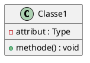

# 🤝 Guide de Contribution

Merci de votre intérêt pour contribuer à ce cours de **Programmation Orientée Objet en Java** ! 🎉

Ce document vous explique comment contribuer efficacement au projet.

---

## 📋 Table des Matières

1. [Types de Contributions](#types-de-contributions)
2. [Comment Contribuer](#comment-contribuer)
3. [Standards de Code](#standards-de-code)
4. [Process de Review](#process-de-review)
5. [Communauté](#communauté)

---

## 🎯 Types de Contributions

### 1. 🐛 Signaler un Bug

Si vous trouvez une erreur (code, explication, faute) :

1. Vérifiez qu'elle n'a pas déjà été signalée dans les [Issues](https://github.com/GUEDDES/Cours-POO-Java/issues)
2. Ouvrez une nouvelle issue avec le template suivant :

```markdown
**Section concernée** : Section X - Nom de la section
**Type d'erreur** : Code / Explication / Faute d'orthographe
**Description** : [Décrivez l'erreur]
**Proposition de correction** : [Si vous avez une idée]
```

---

### 2. 💡 Proposer une Amélioration

Vous avez une idée pour améliorer le cours ?

- Nouvel exercice
- Exemple de code supplémentaire
- Diagramme UML
- Amélioration d'explication

**Process** :
1. Ouvrez une issue avec le tag `enhancement`
2. Décrivez votre proposition
3. Attendez les retours avant de coder

---

### 3. 📝 Corriger une Erreur

Pour corriger directement :

1. **Fork** le dépôt
2. Créez une branche : `git checkout -b fix/description-courte`
3. Faites vos modifications
4. Committez : `git commit -m "fix: correction de [description]"`
5. Poussez : `git push origin fix/description-courte`
6. Ouvrez une **Pull Request**

---

### 4. ✨ Ajouter du Contenu

#### Ajouter un Exemple de Code

**Fichier** : `XX-Nom-Section/exemples/NomExemple.java`

**Template** :
```java
/**
 * Exemple : [Titre de l'exemple]
 * 
 * Objectif : [Ce que cet exemple démontre]
 * Concepts : [Liste des concepts illustrés]
 * 
 * @author [Votre nom]
 */
public class NomExemple {
    public static void main(String[] args) {
        // Code de l'exemple
    }
}
```

---

#### Ajouter un Exercice

**Fichier** : `XX-Nom-Section/exercices/exerciceN.md`

**Structure** :
```markdown
# Exercice N : Titre de l'exercice

## 🎯 Objectif
[Ce que l'étudiant doit apprendre]

## 📋 Énoncé
[Description détaillée]

## 💡 Indications
- Indice 1
- Indice 2

## ✅ Critères de Validation
- [ ] Critère 1
- [ ] Critère 2
```

**+ Fichier Solution** : `XX-Nom-Section/solutions/ExerciceNSolution.java`

---

#### Ajouter un Diagramme UML

**Format accepté** : PlantUML, Mermaid, ou PNG/SVG

**Emplacement** : `XX-Nom-Section/diagrammes/nom-diagramme.puml`

**Exemple PlantUML** :


---

## 📐 Standards de Code

### Convention Java

```java
// ✅ BON
class NomDeClasse {              // PascalCase pour les classes
    private int attribut;        // camelCase pour les attributs
    public static final int MAX = 100;  // MAJUSCULES pour les constantes
    
    public void methode() {      // camelCase pour les méthodes
        int variable = 5;        // camelCase pour les variables
    }
}

// ❌ MAUVAIS
class nom_de_classe {           // Pas de snake_case
    public int Attribut;        // Attribut doit être private
    void Methode() { }          // Pas de PascalCase pour méthodes
}
```

---

### Commentaires

```java
/**
 * Documentation Javadoc pour les classes et méthodes publiques
 * 
 * @param parametre Description du paramètre
 * @return Description du retour
 */
public int methodePublique(int parametre) {
    // Commentaire en ligne pour expliquer la logique complexe
    return parametre * 2;
}
```

---

### Structure des Fichiers

```java
// 1. Package
package com.exemple;

// 2. Imports (groupés et triés)
import java.util.ArrayList;
import java.util.List;

// 3. Classe principale
public class MaClasse {
    // 4. Attributs statiques
    private static int compteur = 0;
    
    // 5. Attributs d'instance
    private String nom;
    
    // 6. Constructeurs
    public MaClasse(String nom) {
        this.nom = nom;
    }
    
    // 7. Méthodes publiques
    public void methodePublique() { }
    
    // 8. Méthodes privées
    private void methodePrivee() { }
}
```

---

## 🔍 Process de Review

### Checklist avant Pull Request

- [ ] Le code compile sans erreur
- [ ] Le code respecte les conventions Java
- [ ] Les commentaires sont clairs et en français
- [ ] Les exemples sont testés et fonctionnels
- [ ] Le README est mis à jour si nécessaire
- [ ] Pas de contenu plagié

---

### Temps de Review

- **Corrections mineures** : 1-2 jours
- **Nouveaux exercices** : 3-5 jours
- **Nouvelles sections** : 1 semaine

---

## 🎨 Style de Rédaction

### Pour les Cours (README.md)

```markdown
# Section X : Titre

## 🎯 Objectifs d'apprentissage

À la fin de cette section, vous serez capable de :
- Objectif 1
- Objectif 2

## 1. Concept Principal

### 1.1 Sous-concept

Explication claire avec exemple.

```java
// Code illustratif
```

**Points clés** :
- Point 1
- Point 2
```

---

### Ton et Style

- ✅ **Clair et pédagogique** : "Une classe est un modèle pour créer des objets"
- ❌ **Trop technique** : "Une classe est une abstraction de type définie par le compilateur"

- ✅ **Exemples concrets** : "Comme une voiture avec un moteur"
- ❌ **Exemples abstraits** : "Comme une entité X avec un composant Y"

- ✅ **Progressif** : Partir du simple vers le complexe
- ❌ **Tout d'un coup** : Expliquer 5 concepts simultanément

---

## 🌍 Traductions

Vous souhaitez traduire le cours ?

1. Créez un dossier `translations/[code-langue]/`
2. Traduisez section par section
3. Conservez la structure originale
4. Ouvrez une PR avec le tag `translation`

**Langues souhaitées** : Anglais, Arabe, Espagnol

---

## 📧 Contact

Pour toute question :

- **Issues GitHub** : [Poser une question](https://github.com/GUEDDES/Cours-POO-Java/issues/new)
- **Discussions** : [Forum du projet](https://github.com/GUEDDES/Cours-POO-Java/discussions)

---

## 🙏 Remerciements

Merci à tous les contributeurs qui rendent ce cours meilleur !

**Liste des contributeurs** : Voir [CONTRIBUTORS.md](CONTRIBUTORS.md)

---

## 📜 Code de Conduite

### Nos Valeurs

- **Respect** : Soyez courtois et constructif
- **Inclusivité** : Bienvenue à tous les niveaux
- **Pédagogie** : L'objectif est d'apprendre
- **Collaboration** : Entraide et partage

### Comportements Inacceptables

- Langage offensant ou discriminatoire
- Harcèlement sous toute forme
- Partage de contenu plagié
- Spam ou publicité

**Signalement** : Contactez le mainteneur principal

---

**Merci de contribuer à l'éducation ouverte ! 🚀**
