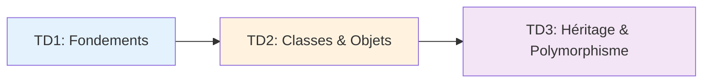

# 📚 Travaux Dirigés (TDs) - POO Java

## 🎯 Vue d'ensemble

Ce dossier contient **3 travaux dirigés progressifs** couvrant les concepts fondamentaux de la Programmation Orientée Objet en Java.

---

## 📝 Liste des TDs

### [TD 1 : Fondements de POO](TD1-Fondements/)

🎯 **Objectifs** : Maîtriser les bases de Java

**Concepts abordés** :
- Structures de contrôle (`for`, `if-else`, `switch`, `do-while`)
- Saisie utilisateur avec `Scanner`
- Types primitifs et chaînes de caractères
- Validation des entrées

**Exercices** :
1. ➡️ Calcul du factoriel
2. ➡️ Calculatrice simple
3. ➡️ Recherche de caractère
4. ➡️ Jeu du nombre secret

🔗 **[Accéder au TD1](TD1-Fondements/)**

---

### [TD 2 : Objets & Classes](TD2-Classes-Objets/)

🎯 **Objectifs** : Maîtriser les concepts fondamentaux de la POO

**Concepts abordés** :
- Création de classes avec attributs privés
- Constructeurs (défaut, paramétrés, copie)
- Méthodes d'instance
- Encapsulation (getters/setters)
- Manipulation de tableaux d'objets
- Redéfinition de `toString()`

**Exercices** :
1. ➡️ Classe Complexe (nombres complexes)
2. ➡️ Classe Etudiant (gestion de notes)

🔗 **[Accéder au TD2](TD2-Classes-Objets/)**

---

### [TD 3 : Révision & Synthèse](TD3-Revision-Synthese/)

🎯 **Objectifs** : Synthétiser les concepts avancés

**Concepts abordés** :
- **Héritage** : extension de classes, `super()`
- **Classe abstraite** : méthodes abstraites/concrètes
- **Interface** : contrats d'implémentation
- **Modificateurs** : `static`, `final`, `protected`
- **Polymorphisme** : tableaux hétérogènes

**Exercices** :
1. ➡️ Questions de cours (théorie)
2. ➡️ Système de gestion de transport (Vehicule, Voiture, Bateau)
3. ➡️ Classe Bibliotheque (attribut `static`)

🔗 **[Accéder au TD3](TD3-Revision-Synthese/)**

---

## 📈 Progression pédagogique



---

## 📊 Structure de chaque TD

Chaque TD contient :

```
TDX-Nom-Section/
├── README.md              # Présentation générale
├── enonce.md              # Énoncés détaillés
├── corrections/           # Code source Java
│   ├── Exercice1.java
│   ├── Exercice2.java
│   └── ...
└── TDX-Corrections.pdf   # Slides Beamer (si disponible)
```

---

## 🛠️ Compilation et Exécution

### Avec `javac` (ligne de commande)

```bash
# Compiler
javac NomFichier.java

# Exécuter
java NomFichier
```

### Avec un IDE

**IntelliJ IDEA / Eclipse / VS Code** :
1. Ouvrir le fichier `.java`
2. Clic droit → `Run`

---

## 📚 Ressources complémentaires

### Documentation officielle
- 🔗 [Oracle Java Tutorials](https://docs.oracle.com/javase/tutorial/)
- 🔗 [Java API Documentation](https://docs.oracle.com/en/java/javase/)

### Cours principal
- 📖 [Retour aux sections de cours](../)
- 💻 [Exemples de code](../exemples/)
- 📊 [Diagrammes UML](../diagrammes/)

---

## ❓ Besoin d'aide ?

1. 📖 Consultez les **corrections complètes** dans chaque TD
2. 📊 Visualisez les **diagrammes UML** pour mieux comprendre
3. 💻 Testez les **exemples de code** fournis
4. 👥 Posez des questions à votre enseignant

---

## 📅 Informations

- **Niveau** : 2ème année Licence Informatique
- **Année Universitaire** : 2025-2026
- **Enseignants** : BEN ABDELJELIL MOUNA & Abdelweheb GUEDDES
- **Institution** : Institut Supérieur d'Informatique et des Technologies de Communication, Hammam Sousse

---

## 🎓 Compétences acquises

Après avoir complété ces 3 TDs, vous serez capable de :

✅ Maîtriser les structures de contrôle Java  
✅ Créer et manipuler des classes et objets  
✅ Appliquer l'encapsulation  
✅ Utiliser l'héritage et le polymorphisme  
✅ Implémenter des interfaces  
✅ Travailler avec des classes abstraites  
✅ Gérer des tableaux d'objets hétérogènes  

---

🏠 **[Retour au dépôt principal](../)**
